<p align="center">
  
</p>

<p align="center">
  <a href="https://www.npmjs.com/package/agent-sweeper"></a>
  <a href="https://github.com/hiyufan/agent-sweep/actions/workflows/ci.yml"></a>
  
  
  <a href="LICENSE"></a>
</p>

<p align="center">
  <b>English</b> · <a href="README.zh-CN.md">简体中文</a>
</p>

---

Your AI coding agents leave things behind. Every Claude Code, Codex and Gemini CLI session writes transcripts that are never cleaned up. Cursor keeps chat history and indexes for projects you deleted months ago. `npx` keeps a copy of every MCP server you have ever tried. Crashed sessions leave **git worktrees** on disk and **MCP servers** running with nobody to talk to.

**agent-sweep finds all of it in one scan, shows you how much space each item takes, and cleans only what you select.**

```sh
npx agent-sweeper
```

<p align="center">
  
</p>

## Why

These are open, long-running complaints, not hypotheticals:

- MCP server processes [are not terminated when a session ends](https://github.com/anthropics/claude-code/issues/22612) and pile up, eating CPU and RAM.
- Agent worktrees under `~/.claude-worktrees` [are never cleaned up](https://github.com/anthropics/claude-code/issues/26725) when a session ends badly.
- `~/.claude` alone [grows past a gigabyte](https://github.com/GarrickZ2/claude-code-cleaner) after a few months of normal use, and that is before Codex, Gemini and your editor.

Each tool ships, at best, a cleanup for its own folder. You probably use more than one.

## What it finds

| | Where | When it is offered |
| --- | --- | --- |
| 🧠 **Orphaned MCP servers** | Running processes | An MCP server with no Claude / Codex / Gemini / Cursor / VS Code process above it |
| 🌳 **Orphaned worktrees** | `~/.claude-worktrees`, `~/.codex/worktrees`, `<repo>/.claude/worktrees` | The repository it belonged to is gone |
| 🌳 **Stale worktrees** | same | No uncommitted changes and idle for `--days` |
| 🌳 **Dangling worktree records** | current repo | `git worktree list` shows them as prunable |
| 💬 **Claude Code** | `~/.claude/projects`, `debug`, `file-history`, `shell-snapshots`, `todos`, … | Idle for `--days`, or the project folder was deleted |
| 💬 **Codex** | `~/.codex/sessions`, `archived_sessions`, `log` | Idle for `--days` |
| 💬 **Gemini CLI** | `~/.gemini/tmp` | Idle for `--days` |
| 💬 **opencode** | `~/.local/share/opencode/log` | Idle for `--days` |
| 🖥️ **Cursor, Windsurf, VS Code** | `workspaceStorage` | The workspace folder no longer exists |
| 📦 **npx cache** | `~/.npm/_npx` | Unused for `--days` (npx re-downloads on demand) |

The interface speaks English and Chinese (简体中文), picked from your system locale; override with `--lang` or `AGENT_SWEEP_LANG`.

Honors `CLAUDE_CONFIG_DIR`, `CODEX_HOME`, `XDG_*`, `APPDATA` and `npm_config_cache`. Works on macOS, Linux and Windows (process scanning is macOS and Linux only).

## Safe by default

Deleting things in someone's home folder is serious, so agent-sweep is built to make mistakes hard:

- **Dry-run unless you pass `--apply`.** Even then, every clean asks `[y/N]` first.
- **Allow-listed folders only.** Every delete is checked against the agents' own folders at run time; anything outside is refused.
- **Your config is never a target.** Settings, `CLAUDE.md`, credentials, skills, commands, agents and per-project memory are never offered.
- **Live sessions are left alone.** Anything touched in the last hour is skipped, whatever `--days` says.
- **Git is asked, not bypassed.** Stale worktrees go through `git worktree remove` without `--force`, so uncommitted work blocks removal, and the branch is kept.
- **Processes get a chance to exit.** `SIGTERM` first, `SIGKILL` only after 3 seconds.
- **Zero runtime dependencies**, so `npx agent-sweeper` runs the code in this repo and nothing else.

## Usage

```sh
npx agent-sweeper                  # interactive, dry-run
npx agent-sweeper --apply          # interactive, really cleans after you confirm
npx agent-sweeper --days 30        # only things idle for a month
npx agent-sweeper --only process   # just the zombie MCP servers
npx agent-sweeper --list           # print findings, then exit
npx agent-sweeper --json | jq      # machine-readable findings
```

| Key | Action |
| --- | --- |
| `↑` `↓` / `j` `k` | Move |
| `space` | Select / unselect |
| `a` | Select all / none |
| `s` | Sort by kind, size or age |
| `enter` | Clean the selection (asks first) |
| `q` | Quit and print a summary |

| Option | Default | Meaning |
| --- | --- | --- |
| `--days <n>` | `14` | How long something must be idle to count as stale |
| `--only <kinds>` | all | Comma list of `cache`, `worktree`, `process` |
| `--apply` | off | Really delete and kill (still confirms) |
| `--list` | | Print findings and exit; never deletes |
| `--json` | | Print findings as JSON and exit; never deletes |
| `--lang <en\|zh>` | system | Interface language |

## FAQ

<details>
<summary><b>Will I lose conversation history?</b></summary>

For the sessions you select, yes: that is the space being freed. Claude Code's `--resume` and Codex's history will no longer list them. Sessions used within `--days` (14 by default) are never offered.
</details>

<details>
<summary><b>Why not just <code>rm -rf ~/.claude</code>?</b></summary>

Because that folder also holds your settings, `CLAUDE.md`, skills, commands, agents and project memory. agent-sweep only offers the parts that are safe to lose.
</details>

<details>
<summary><b>How does it decide an MCP server is orphaned?</b></summary>

It walks each MCP process's parent chain. If no agent or editor is anywhere above it (typically its parent is now `init` / `launchd`), nobody can talk to it any more. Only processes owned by you are considered, and only the top of each orphaned tree is listed.
</details>

<details>
<summary><b>What does the <code>*</code> after a size mean?</b></summary>

That number is the process's memory (RSS), not disk space. It is not counted in the "reclaimable" total.
</details>

<details>
<summary><b>My tool is missing.</b></summary>

[Open an issue](https://github.com/hiyufan/agent-sweep/issues/new?template=new_agent.yml) with the folders it leaves behind, or see [CONTRIBUTING.md](CONTRIBUTING.md): most new targets are a few lines plus a test.
</details>

## Roadmap

- [ ] Aider, Cline, Continue and Roo Code
- [ ] `uvx` cache for Python MCP servers
- [ ] Per-tool totals and a "since last run" report
- [ ] Optional `--yes` for scheduled cleanups

## Contributing

Issues and PRs are welcome. `npm install && npm test` is all the setup there is; see [CONTRIBUTING.md](CONTRIBUTING.md).

If agent-sweep gave you some disk back, a ⭐ helps other people find it.

## License

[MIT](LICENSE)
