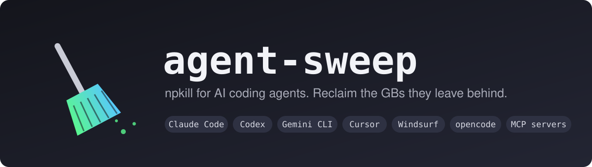

<p align="center">
  
</p>

<p align="center">
  <a href="https://www.npmjs.com/package/agent-sweeper"></a>
  <a href="https://github.com/hiyufan/agent-sweep/actions/workflows/ci.yml"></a>
  
  
  <a href="LICENSE"></a>
</p>

<p align="center">
  <a href="README.md">English</a> · <b>简体中文</b>
</p>

---

AI 编程工具用久了，会悄悄留下一堆东西：Claude Code、Codex、Gemini CLI 的每次会话记录都不会自动清理；Cursor 还替你保存着几个月前就删掉的项目的聊天记录和索引；`npx` 把你试过的每个 MCP 服务器都留了一份；会话异常退出后，硬盘上还剩着 **git worktree**，后台还跑着没人理的 **MCP 进程**。

**agent-sweep 一次扫描把这些全部找出来，列出每一项占多少空间，只清理你勾选的部分。**

```sh
npx agent-sweeper
```

<p align="center">
  
</p>

<sub>演示用的是一个示例 home 目录，由 [`scripts/record-demo.py`](scripts/record-demo.py) 从真实 CLI 录制。</sub>

## 为什么需要它

这些都是长期存在、至今仍开着的问题：

- 会话结束后 [MCP 子进程不会被终止](https://github.com/anthropics/claude-code/issues/22612)，越积越多，持续占用 CPU 和内存。
- 会话异常退出时，`~/.claude-worktrees` 下的 worktree [从不会被清理](https://github.com/anthropics/claude-code/issues/26725)。
- 正常用几个月，光 `~/.claude` 就能[涨到 1 GB 以上](https://github.com/GarrickZ2/claude-code-cleaner)，这还没算 Codex、Gemini 和编辑器。

每家工具最多只清理自己的目录，而你大概率不止用一个。

## 能找到什么

| | 位置 | 什么情况下会列出 |
| --- | --- | --- |
| 🧠 **孤儿 MCP 进程** | 正在运行的进程 | 上层已经没有 Claude / Codex / Gemini / Cursor / VS Code 进程 |
| 🌳 **孤儿 worktree** | `~/.claude-worktrees`、`~/.codex/worktrees`、`<仓库>/.claude/worktrees` | 所属仓库已经不存在 |
| 🌳 **闲置 worktree** | 同上 | 没有未提交的改动，且闲置超过 `--days` |
| 🌳 **悬空的 worktree 记录** | 当前仓库 | `git worktree list` 显示为 prunable |
| 💬 **Claude Code** | `~/.claude/projects`、`debug`、`file-history`、`shell-snapshots`、`todos` 等 | 闲置超过 `--days`，或项目文件夹已被删除 |
| 💬 **Codex** | `~/.codex/sessions`、`archived_sessions`、`log` | 闲置超过 `--days` |
| 💬 **Gemini CLI** | `~/.gemini/tmp` | 闲置超过 `--days` |
| 💬 **opencode** | `~/.local/share/opencode/log` | 闲置超过 `--days` |
| 🖥️ **Cursor、Windsurf、VS Code** | `workspaceStorage` | 对应的工作区文件夹已不存在 |
| 📦 **npx 缓存** | `~/.npm/_npx` | 超过 `--days` 没用过（需要时 npx 会重新下载） |

**界面自带中文**：系统语言是中文时自动显示中文，也可以用 `--lang zh` 或环境变量 `AGENT_SWEEP_LANG=zh` 指定。

支持 `CLAUDE_CONFIG_DIR`、`CODEX_HOME`、`XDG_*`、`APPDATA`、`npm_config_cache` 等环境变量。支持 macOS、Linux 和 Windows（进程扫描仅支持 macOS 和 Linux）。

## 默认安全

在别人的 home 目录里删东西是件严肃的事，所以 agent-sweep 的设计让误删很难发生：

- **不加 `--apply` 就是 dry-run。** 加了也要先按 `[y/N]` 确认。
- **只在白名单目录里删除。** 每次删除前都会校验路径是否在各 Agent 自己的目录内，不在就拒绝。
- **配置永远不会被列出。** 设置、`CLAUDE.md`、凭证、skills、commands、agents 和项目记忆都不会出现在列表里。
- **不碰正在用的会话。** 最近 1 小时内动过的东西一律跳过，`--days` 设成多少都一样。
- **通过 git 删除，不绕过 git。** 闲置 worktree 用不带 `--force` 的 `git worktree remove` 删除，有未提交改动就删不掉，分支也会保留。
- **给进程留退出时间。** 先发 `SIGTERM`，3 秒后还在才 `SIGKILL`。
- **零运行时依赖**，`npx agent-sweeper` 运行的只有这个仓库里的代码。

## 用法

```sh
npx agent-sweeper                  # 交互界面，dry-run
npx agent-sweeper --apply          # 交互界面，确认后真正清理
npx agent-sweeper --days 30        # 只看闲置超过一个月的
npx agent-sweeper --only process   # 只看僵尸 MCP 进程
npx agent-sweeper --list           # 打印结果后退出
npx agent-sweeper --json | jq      # 输出 JSON
```

| 按键 | 作用 |
| --- | --- |
| `↑` `↓` / `j` `k` | 移动 |
| `space` | 勾选 / 取消 |
| `a` | 全选 / 全不选 |
| `s` | 按类型、大小或时间排序 |
| `enter` | 清理已选项（会先确认） |
| `q` | 退出并打印汇总 |

| 参数 | 默认值 | 含义 |
| --- | --- | --- |
| `--days <n>` | `14` | 闲置多少天算过期 |
| `--only <kinds>` | 全部 | 逗号分隔：`cache`、`worktree`、`process` |
| `--apply` | 关 | 真正删除和结束进程（仍需确认） |
| `--list` | | 打印结果后退出，不会删除 |
| `--json` | | 以 JSON 输出后退出，不会删除 |
| `--lang <en\|zh>` | 跟随系统 | 界面语言 |

## 常见问题

<details>
<summary><b>会丢失聊天记录吗？</b></summary>

你勾选的那些会话会丢，释放的正是这部分空间。之后 Claude Code 的 `--resume` 和 Codex 的历史里就看不到它们了。最近 `--days` 天（默认 14 天）用过的会话不会被列出。
</details>

<details>
<summary><b>为什么不直接 <code>rm -rf ~/.claude</code>？</b></summary>

因为这个目录里还有你的设置、`CLAUDE.md`、skills、commands、agents 和项目记忆。agent-sweep 只列出可以安全丢掉的部分。
</details>

<details>
<summary><b>怎么判断 MCP 进程是孤儿？</b></summary>

它会沿着每个 MCP 进程的父进程链往上查。如果上面已经没有任何 Agent 或编辑器（通常父进程变成了 `init` / `launchd`），就说明已经没人会再和它通信了。只考虑你自己用户下的进程，每棵孤儿进程树只列出最顶层的那个。
</details>

<details>
<summary><b>大小后面的 <code>*</code> 是什么意思？</b></summary>

表示这是进程占用的内存（RSS），不是磁盘空间，不计入"可释放"总量。
</details>

<details>
<summary><b>我用的工具还不支持？</b></summary>

欢迎[提 issue](https://github.com/hiyufan/agent-sweep/issues/new?template=new_agent.yml)，写明它会留下哪些目录；也可以看 [CONTRIBUTING.md](CONTRIBUTING.md) 自己加，大多数新目标只要几行代码加一个测试。
</details>

## 路线图

- [ ] 支持 Aider、Cline、Continue、Roo Code
- [ ] 清理 Python MCP 服务器用的 `uvx` 缓存
- [ ] 按工具汇总，以及"距上次清理"报告
- [ ] 可选的 `--yes`，方便定时清理

## 参与贡献

欢迎提 issue 和 PR。准备工作只有 `npm install && npm test`，详见 [CONTRIBUTING.md](CONTRIBUTING.md)。

如果 agent-sweep 帮你腾出了空间，点个 ⭐ 能让更多人看到它。

## 许可证

[MIT](LICENSE)
